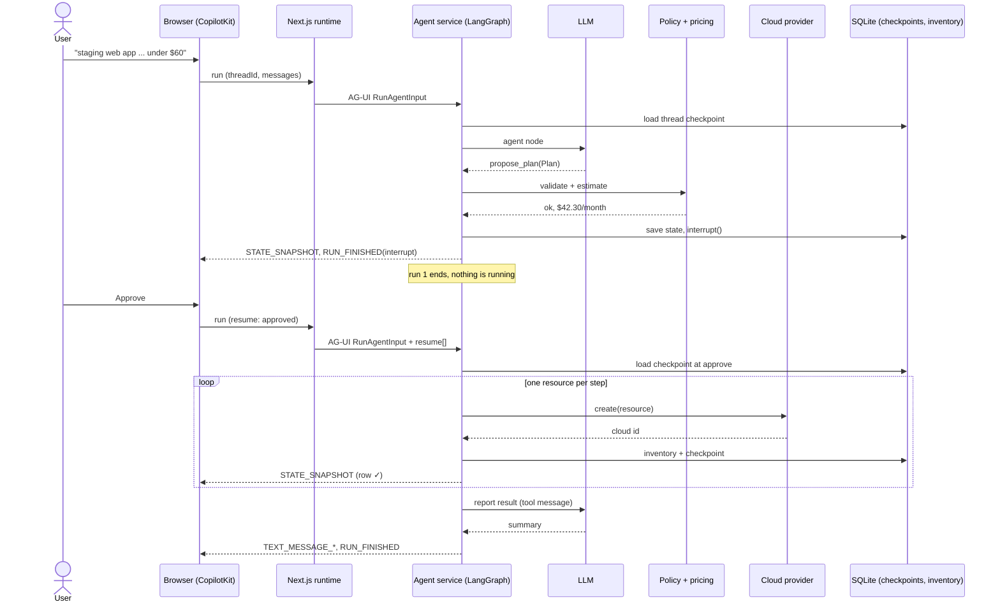

# Orchestrating a service flow with an agentic workflow

How one request moves through every service in `cloud_provisioner`, step by step, and who is in
charge at each step. For the graph's internals (nodes, policy, `interrupt()`), see [FLOW.md](FLOW.md).

## 1. The services

```
┌─────────────┐   ┌──────────────────┐   ┌────────────────────────────┐   ┌──────────────┐
│  Browser    │──▶│ Next.js server   │──▶│ Python agent service       │──▶│ Cloud        │
│ CopilotKit  │   │ CopilotRuntime   │   │ FastAPI + ag-ui-langgraph  │   │ FakeCloud or │
│ React UI    │◀──│ /api/copilotkit  │◀──│ LangGraph graph (:8001)    │◀──│ AWS (boto3)  │
└─────────────┘   └──────────────────┘   └─────┬──────────┬───────────┘   └──────────────┘
   :3001            forwards only               │          │
                                           ┌────▼───┐ ┌────▼────────────┐
                                           │ LLM    │ │ SQLite          │
                                           │ litellm│ │ checkpoints.db  │
                                           └────────┘ │ inventory.db    │
                                                      └─────────────────┘
```

| Service | Job | Has AI logic? |
|---|---|---|
| Browser (`web/app/page.tsx`) | chat, plan panel, approve card, inventory | no |
| Next.js runtime (`web/app/api/copilotkit`) | forwards browser runs to the agent over AG-UI | no |
| Agent service (`server.py` → `graph.py`) | **the orchestrator**: runs the workflow | yes (one node) |
| LLM (`gpt-4o-mini` via litellm) | understands the request, drafts plans, explains | it *is* the AI |
| Policy and pricing (`policy.py`, `catalog.py`) | decide whether a plan is allowed and what it costs | no, plain code |
| Provider (`cloud.py`, `aws_cloud.py`) | create and delete real (or fake) resources | no |
| `checkpoints.db` | the workflow's memory: every step of every thread | — |
| `inventory.db` | what exists in the cloud (like a Terraform state file) | — |

**The orchestrator is the LangGraph graph, not the LLM.** The graph's edges decide the order of
services. The LLM is one service the graph calls, at the `agent` node.

## 2. Agentic vs deterministic: who decides what

```
           AGENTIC (LLM decides)              DETERMINISTIC (code decides)          HUMAN
        ┌──────────────────────────┐   ┌──────────────────────────────────┐   ┌──────────┐
        │ agent: what to ask,      │──▶│ plan → validate → estimate       │──▶│ approve  │
        │ which tool, which plan   │◀──│ (reject = tool result to the LLM)│   └────┬─────┘
        └──────────────────────────┘   │ apply ⟲ → report                 │◀───────┘
                                       └──────────────────────────────────┘
```

The rule: **the LLM may choose *what* to propose. Code and a human decide *whether* it happens.**
Every path back to the LLM is a tool result, so it can only react by proposing again.

## 3. One request end to end

*"staging web app in us-east-1: 2 web servers, https open to everyone, a small postgres, under $60/month"*

### Run 1: from the message to the approval pause

| # | From → To | What crosses the boundary | What happens |
|---|---|---|---|
| 1 | Browser → Next.js | `POST /api/copilotkit/agent/default/run` with threadId, messages, state | `CopilotChat` sends the user's message |
| 2 | Next.js → Agent service | `POST :8001/agent`, an AG-UI `RunAgentInput` | `HttpAgent` forwards it; the runtime adds no logic |
| 3 | Agent service → checkpoints.db | read the checkpoint for `thread_id` | the graph loads the thread's earlier state, if any |
| 4 | Graph → LLM | system prompt + catalog + messages | **agent node**: the LLM chooses `list_resources` and `list_catalog` |
| 5 | Graph → inventory.db | read | **tools node** answers; results go back to the LLM |
| 6 | Graph → LLM | messages + tool results | the LLM calls `propose_plan` with a structured `Plan` |
| 7 | Graph (code) | — | **plan** builds the action queue, **validate** runs the policy, **estimate** prices it |
| 7a | — | — | *if a rule fails:* the problems become the tool result, and steps 6–7 repeat |
| 8 | Graph → checkpoints.db | state at `approve` | **approve** calls `interrupt()`: the graph saves and stops |
| 9 | Agent service → Browser | SSE: `TOOL_CALL_*`, `STATE_SNAPSHOT`, `RUN_FINISHED {outcome: interrupt}` | tool cards, the plan panel and the approve card appear |

**HTTP run 1 is now over.** No process is waiting. The paused workflow exists only as a row in
`checkpoints.db`, so the human can take a minute or a day, and the server can restart in between.

### The human decision

| # | Who | What |
|---|---|---|
| 10 | Human | reads the plan panel (resources, cost, budget) and clicks **Approve**, or **Reject** with a reason |

### Run 2: from the decision to the result

| # | From → To | What crosses the boundary | What happens |
|---|---|---|---|
| 11 | Browser → Next.js → Agent service | `RunAgentInput` with `resume: [{interruptId, status: "resolved", payload: {approved: true}}]` | `useInterrupt`'s `resolve()` starts a new run on the **same thread** |
| 12 | Agent service → Graph | `Command(resume={approved: true})` | the adapter turns AG-UI `resume[]` into a LangGraph resume |
| 13 | Graph | — | **approve** runs again; `interrupt()` now *returns* the decision |
| 13a | — | — | *if rejected:* the reason becomes the tool result, and the flow goes back to step 6 (a new plan, a new run 1) |
| 14 | Graph → Provider → Cloud | `create(resource, env, region, refs)` | **apply** creates *one* resource |
| 15 | Graph → inventory.db, checkpoints.db | the new cloud id; the step's state | record what exists; save progress |
| 16 | Agent service → Browser | SSE: `STATE_SNAPSHOT` | that row in the plan panel turns ✓ |
| 17 | — | — | repeat 14–16 for each resource; a transient error retries the same resource (up to 3 tries) |
| 18 | Graph | ToolMessage on the `propose_plan` call | **report** gives the outcome to the LLM |
| 19 | Graph → LLM → Browser | SSE: `TEXT_MESSAGE_*`, `RUN_FINISHED` | the LLM explains the result; the inventory panel refreshes from `GET /inventory` |

## 4. The same flow as a sequence diagram



## 5. Where the state lives

| State | Stored in | Keyed by | Survives |
|---|---|---|---|
| conversation + plan + progress | `checkpoints.db` (checkpointer) | `thread_id` | page reloads, server restarts, the approval pause |
| what exists in the cloud | `inventory.db` | resource name | everything; it is the record used to destroy |
| UI copy of the state | browser memory | — | until reload; rebuilt from `STATE_SNAPSHOT` events |

The browser and the Next.js runtime are **stateless**. You can restart either one at any time.

The runtime is optional. `web_plain/index.html` skips it and POSTs AG-UI straight to the agent service
(steps 1–2 become a single hop). It must then send its last `STATE_SNAPSHOT` back as `state` on each
run, as CopilotKit does: the adapter builds the first snapshot of a resumed run from it.

## 6. When something goes wrong

| Failure | Where it is caught | What the user sees |
|---|---|---|
| the LLM drafts an unsafe or invalid plan | `validate` (policy) | issues in the panel; the agent proposes a fixed plan |
| the plan is over budget | `estimate` | "over budget"; the agent picks smaller resources |
| the human rejects | `approve` | the agent revises using the reason |
| capacity or throttling error | `apply` → `TransientError` | the row shows ↻, then ✓ |
| a permanent cloud error | `apply` → failed, then stop | the row shows ✗; the report says which resources are kept |
| the agent service crashes mid-apply | checkpointer | the next run on the thread continues at the next resource |
| the browser closes during approval | checkpointer | open the thread again; it is still waiting at `approve` |
| someone asks to destroy prod | `check_destroy` | blocked; "open a change request" |

## 7. Patterns to reuse for any service flow

1. **One orchestrator owns the order.** Write the flow as graph edges. Don't leave the order to the LLM's judgement.
2. **The LLM proposes through a typed tool.** A Pydantic schema turns free text into a contract other services can check.
3. **Put a deterministic gate before every side effect:** validation, pricing, quota.
4. **Approval is a pause, not a message.** `interrupt()` and a checkpointer let the flow wait across HTTP requests, restarts and days.
5. **Use small, checkpointed steps for side effects.** You get progress events, retries and crash recovery from the same design.
6. **Every outcome goes back to the LLM as a tool result.** It can explain or retry, but it can't skip a gate.
7. **Keep the services behind thin interfaces.** AG-UI separates the UI from the agent, and `create` / `delete` separates the agent from the cloud. Either side can be swapped: another UI, LocalStack, AWS.

## Try it

```bash
uv run server.py                          # agent service on :8001
cd web && npm run dev                     # UI on :3001
```

Open the browser devtools' Network tab, send a request, and watch the two `run` calls (before and after
you click Approve) and their SSE events. That is the orchestration above, live.
